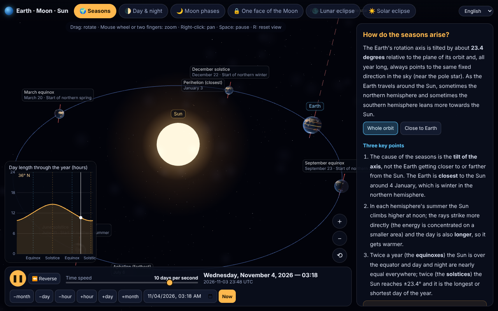

[English](README.md) · [فارسی](README.fa.md) · **Español**

### ▶ [Demo en línea](https://mahdial.github.io/Earth-Moon-Sun-simulator/?lang=es)  ·  [Live demo](https://mahdial.github.io/Earth-Moon-Sun-simulator/?lang=en)  ·  [دموی فارسی](https://mahdial.github.io/Earth-Moon-Sun-simulator/?lang=fa)

# Simulador Tierra · Luna · Sol

Un simulador 3D interactivo y preciso del sistema Tierra–Luna–Sol que funciona en **un solo archivo HTML**. No hace falta servidor especial, ni framework, ni compilar nada para usarlo: abra `docs/index.html` en el navegador o súbalo a cualquier alojamiento estático.

Está hecho para **explicar**: cada modo tiene una breve explicación escrita, datos en vivo y controles para experimentar («¿qué pasaría si la inclinación de la Tierra fuera 0°?»).



## Qué muestra

| Modo | Qué se aprende |
|---|---|
| 🌍 **Estaciones** | Por qué existen las estaciones (inclinación del eje, no la distancia). Vista de la órbita con las cuatro posiciones de equinoccio y solsticio, perihelio y afelio, duración del día a lo largo del año en cualquier latitud y un control deslizante de la inclinación (pruebe 0° o 90°). |
| 🌓 **Día y noche** | El terminador, las fases del crepúsculo, amanecer y atardecer, hora solar frente a hora oficial, día y noche polares. Elija cualquier lugar del globo. |
| 🌙 **Fases lunares** | Las fases vistas desde arriba y de lado, la Luna vista desde la Tierra, escala real, y por qué las fases *no* son la sombra de la Tierra. |
| 🔒 **Una cara de la Luna** | El acoplamiento de marea, con experimentos: ¿y si la Luna no girara? ¿y si girara una vez al día? Además, la libración. |
| 🌑 **Eclipse lunar** | Umbra y penumbra a escala real, una lista de eclipses reales (desde 2025), sección de la sombra y por qué no hay uno cada mes (inclinación orbital y nodos). |
| ☀️ **Eclipse solar** | La sombra de la Luna sobre la Tierra, el cielo del observador con la corona, eclipses total, anular y parcial, y la coincidencia 400 × 400. |

## Características

- **Astronomía precisa.** Las posiciones del Sol, la Luna y la Tierra provienen de [astronomy-engine](https://github.com/cosinekitty/astronomy) (precisión de una fracción de minuto de arco), con precesión y nutación del eje, tiempo sidéreo y libración lunar. Rango de fechas: 1900–2100.
- **Geometría real de los eclipses.** Las sombras se calculan píxel a píxel a partir del solapamiento exacto de los discos del Sol y del cuerpo que lo oculta, de modo que la penumbra, la umbra y los anillos anulares no son un efecto falso.
- **Rápido en móviles y ordenadores.** Solo se redibuja cuando algo cambia y la resolución se adapta sola. Toda la aplicación (código y texturas) pesa unos 1,6 MB.
- **Ratón, táctil y teclado.** Arrastrar: girar · rueda o dos dedos: zoom · clic derecho: desplazar · `Espacio`: pausa · `[` y `]`: velocidad · `R`: restablecer vista · `1`–`6`: cambiar de modo · `N`: ir a ahora.
- **Control del tiempo.** Desde tiempo real hasta 100 días por segundo, marcha atrás, selector de fecha y botones de salto.
- **Tres idiomas.** Persa (con calendario jalali y diseño de derecha a izquierda), inglés y español. Se cambia en la barra superior o con `?lang=fa|en|es`.

## Cómo usarlo

**Solo ábralo:** descargue `docs/index.html` y ábralo en un navegador moderno (con WebGL). Para alojarlo usted mismo, suba ese único archivo a cualquier servidor web estático.

**GitHub Pages:** *Settings → Pages → Deploy from a branch → `main` / `/docs`*.

## Compilar desde el código fuente

Requiere Node.js 18 o superior.

```bash
npm install
npm run build     # empaqueta src/ y tex/ en docs/index.html
npm run check     # comprueba que las traducciones estén completas y los cálculos astronómicos
```

### Añadir o corregir una traducción

Todos los textos están en `src/dict.js` con la forma `clave: [persa, inglés, español]`. Las listas usan `a|b|c` y los marcadores `{0}` `{1}`. Ejecute `npm run check` para asegurarse de que cada clave existe en los tres idiomas.

## Precisión y escala

- En los modos de **eclipses** y en la opción de **escala real** de las fases lunares, todo está a escala real.
- En **Estaciones** y en la vista predeterminada de las **fases lunares**, los tamaños y distancias se exageran a propósito para que se lean bien, y así se indica en pantalla.
- Las texturas son simbólicas (sin nubes) y las magnitudes de los eclipses son geométricas.
- No está pensado para la navegación ni para planificar la observación de un eclipse real.

## Créditos

[three.js](https://threejs.org) (MIT) · [astronomy-engine](https://github.com/cosinekitty/astronomy) de Don Cross (MIT) · [esbuild](https://esbuild.github.io). Las texturas de la Tierra y la Luna derivan de las texturas planetarias de los ejemplos de three.js (basadas en imágenes de la NASA); vea [`tex/README.md`](tex/README.md).

## Licencia

Código: [MIT](LICENSE).
