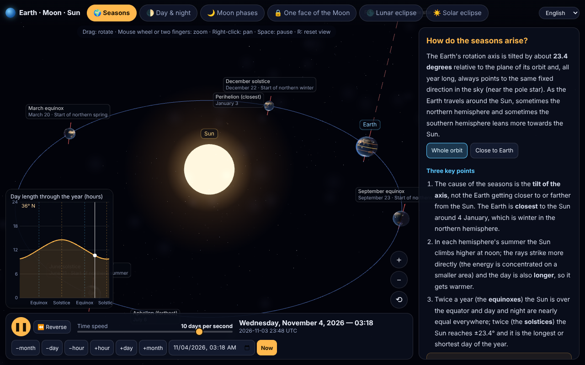

<div dir="rtl">

# شبیه‌ساز زمین · ماه · خورشید

[English](README.md) · **فارسی**

یک شبیه‌ساز سه‌بعدی، تعاملی و دقیق از منظومه‌ی زمین–ماه–خورشید که در **یک فایل HTML** اجرا می‌شود. نیازی به سرور خاص و فریم‌ورک نیست: فایل `docs/index.html` را در مرورگر باز کنید یا روی هر هاست ایستا بگذارید.

هدفش **توضیح‌دادن** است: هر بخش یک متن آموزشی کوتاه، اطلاعات لحظه‌ای و ابزار آزمایش دارد (مثلاً «اگر کجی محور زمین ۰° بود چه می‌شد؟»).



## چه چیزهایی را نشان می‌دهد

| بخش | چه یاد می‌گیرید |
|---|---|
| 🌍 **فصل‌ها** | چرا فصل داریم (کجی محور، نه فاصله). نمای مدار با چهار موقعیت اعتدال و انقلاب، حضیض و اوج، طول روز در هر عرض جغرافیایی در طول سال، و لغزنده‌ی کجی محور (۰° یا ۹۰° را امتحان کنید). |
| 🌓 **شب و روز** | پایانه (ترمیناتور)، مراحل گرگ‌ومیش، طلوع و غروب، ساعت خورشیدی و ساعت رسمی، شبِ قطبی و روزِ قطبی. هر نقطه‌ی کره را انتخاب کنید. |
| 🌙 **فازهای ماه** | فازها از بالا و از کنار، ماه از دید زمین، مقیاس واقعی، و اینکه فازها ربطی به سایه‌ی زمین ندارند. |
| 🔒 **یک روی ماه** | قفل جزرومدی با آزمایش: «اگر ماه نمی‌چرخید؟» و «اگر روزی یک بار می‌چرخید؟» و همچنین لیبراسیون. |
| 🌑 **خسوف** | سایه‌ی اصلی و نیم‌سایه در مقیاس واقعی، فهرست خسوف‌های واقعی (از ۲۰۲۵)، مقطع سایه، و اینکه چرا هر ماه خسوف نداریم. |
| ☀️ **کسوف** | سایه‌ی ماه روی زمین، آسمان از دید ناظر همراه با تاج خورشید، کسوف کلی/حلقوی/جزئی و «تصادف ۴۰۰ در ۴۰۰». |

## ویژگی‌ها

- **نجوم دقیق.** موقعیت خورشید، ماه و زمین با [astronomy-engine](https://github.com/cosinekitty/astronomy) (دقت کسری از دقیقه‌ی قوسی) محاسبه می‌شود؛ شامل تقدیم و ناهمواری محور، زمان نجومی و لیبراسیون. بازه‌ی تاریخ: ۱۹۰۰ تا ۲۱۰۰.
- **هندسه‌ی واقعی خسوف و کسوف.** سایه‌ها برای هر پیکسل از هم‌پوشانی دقیق قرص خورشید و جسم پوشاننده محاسبه می‌شود.
- **سریع روی موبایل و دسکتاپ.** فقط وقتی چیزی تغییر می‌کند رسم می‌شود و وضوح خودکار تنظیم می‌شود. کل برنامه (کد و بافت‌ها) حدود ۱٫۶ مگابایت است.
- **ماوس، لمس و صفحه‌کلید.** کشیدن: چرخش · چرخ ماوس یا دو انگشت: زوم · راست‌کلیک: جابه‌جایی · `Space`: توقف · `[` و `]`: سرعت · `R`: بازنشانی دید · `۱` تا `۶`: تعویض بخش.
- **کنترل زمان.** از زمان واقعی تا ۱۰۰ روز در ثانیه، حالت معکوس، انتخاب تاریخ.
- **سه زبان.** فارسی (با تاریخ شمسی و چیدمان راست‌به‌چپ)، انگلیسی و اسپانیایی. از نوار بالا یا با `?lang=fa|en|es`.

## استفاده

**فقط باز کنید:** فایل `docs/index.html` را دانلود و در یک مرورگر جدید (با WebGL) باز کنید. برای میزبانی شخصی همین یک فایل را روی هر وب‌سرور ایستا آپلود کنید.

**GitHub Pages:** *Settings → Pages → Deploy from a branch → `main` / `/docs`*.

## ساخت از روی سورس

به Node.js نسخه‌ی ۱۸ یا بالاتر نیاز دارد.

</div>

```bash
npm install
npm run build     # src/ و tex/ را در docs/index.html ادغام می‌کند
npm run check     # بررسی کامل‌بودن ترجمه‌ها و درستی محاسبات نجومی
```

<div dir="rtl">

### افزودن یا اصلاح ترجمه

همه‌ی متن‌ها در `src/dict.js` به شکل `کلید: [فارسی, انگلیسی, اسپانیایی]` هستند. فهرست‌ها با `a|b|c` و جایگزین‌ها با `{0}` و `{1}` نوشته می‌شوند. با `npm run check` مطمئن شوید هر کلید در هر سه زبان وجود دارد.

## دقت و مقیاس

- در بخش‌های **خسوف و کسوف** و گزینه‌ی **مقیاس واقعی** در فازهای ماه، همه‌چیز در مقیاس واقعی است.
- در **فصل‌ها** و نمای پیش‌فرض **فازهای ماه**، اندازه‌ها و فاصله‌ها برای خوانایی عمداً بزرگ‌نمایی شده‌اند و روی صحنه نوشته شده است.
- بافت‌ها نمادین هستند (بدون ابر) و پوشیدگی در خسوف هندسی است.
- برای ناوبری یا برنامه‌ریزی دقیق رصد یک گرفت واقعی ساخته نشده است.

## سپاس

[three.js](https://threejs.org) · [astronomy-engine](https://github.com/cosinekitty/astronomy) · [esbuild](https://esbuild.github.io). بافت‌های زمین و ماه برگرفته از بافت‌های سیاره‌ای نمونه‌های three.js (بر پایه‌ی تصاویر ناسا) هستند؛ [`tex/README.md`](tex/README.md) را ببینید.

## مجوز

کد: [MIT](LICENSE).

</div>
