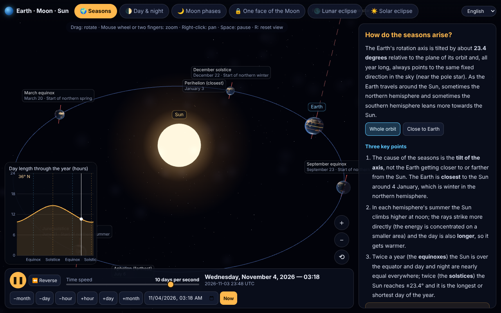
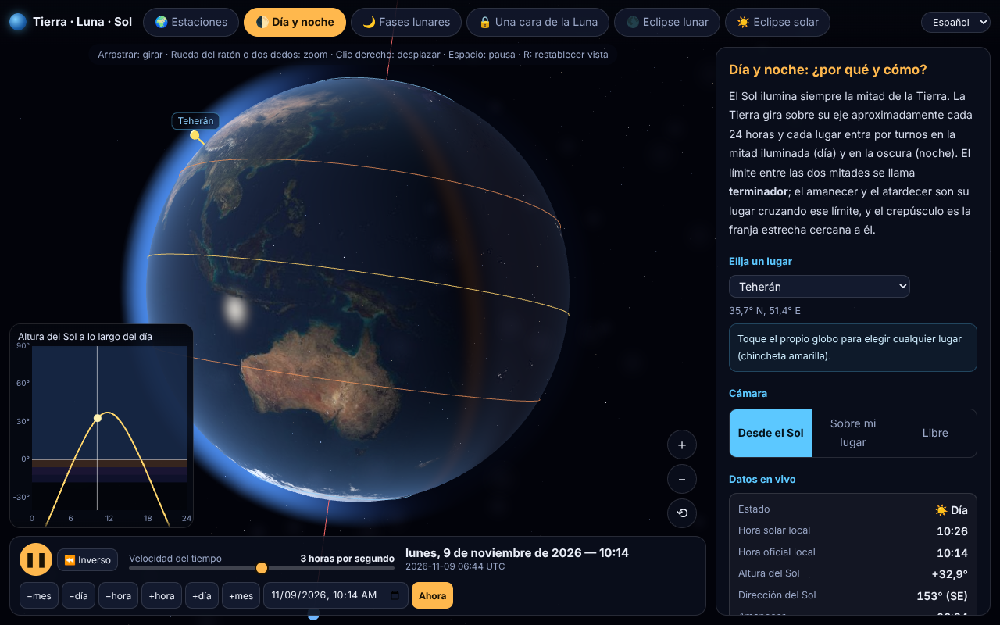
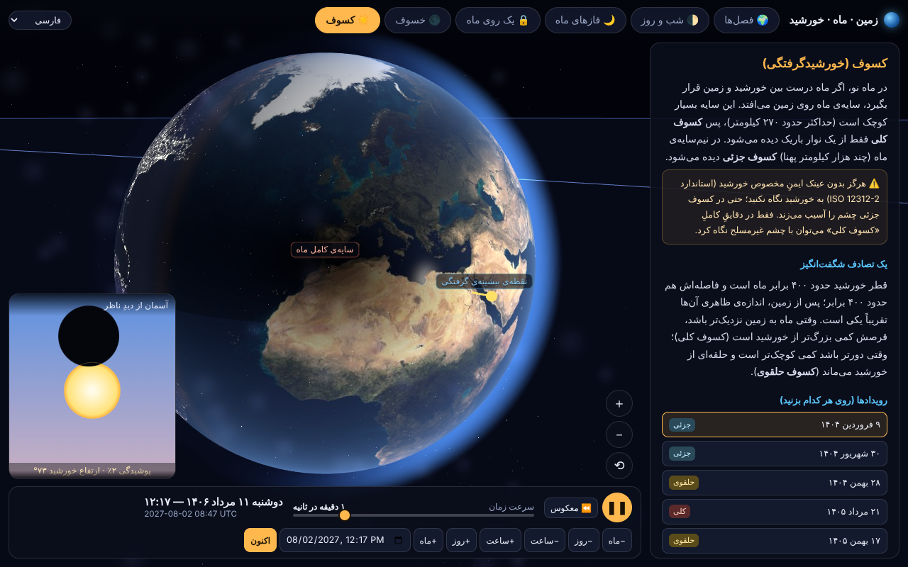

# Earth · Moon · Sun Simulator

**English** · [فارسی](README.fa.md) · [Español](README.es.md)

### ▶ [Live demo](https://mahdial.github.io/Earth-Moon-Sun-simulator/?lang=en)  ·  [Demo en español](https://mahdial.github.io/Earth-Moon-Sun-simulator/?lang=es)  ·  [دموی فارسی](https://mahdial.github.io/Earth-Moon-Sun-simulator/?lang=fa)

An interactive, physically accurate 3D simulator of the Earth–Moon–Sun system that runs in a **single HTML file**. No server, no framework, no build step needed to use it: open `docs/index.html` in a browser or drop it on any static host.

It is made to *explain*: every mode has a short written explanation, live readouts and controls to experiment with ("what if the Earth's tilt were 0°?").



## What it shows

| Mode | What you learn |
|---|---|
| 🌍 **Seasons** | Why the seasons exist (axial tilt, not distance). Orbit view with the four equinox/solstice positions, perihelion/aphelion, day length through the year at any latitude, and an axial-tilt slider (try 0° or 90°). |
| 🌓 **Day & night** | The terminator, twilight stages, sunrise/sunset, local solar time vs. clock time, polar day and night. Pick any place on the globe. |
| 🌙 **Moon phases** | Phases from above and from the side, the Moon as seen from Earth, true-scale option, why phases are *not* Earth's shadow. |
| 🔒 **One face of the Moon** | Tidal locking, with experiments: *what if the Moon did not spin?* / *spun once a day?* Plus libration. |
| 🌑 **Lunar eclipse** | Umbra and penumbra at true scale, a list of real eclipses (2025 →), shadow cross-section, why there is not one every month (orbital tilt and nodes). |
| ☀️ **Solar eclipse** | The Moon's shadow on the Earth, the observer's sky view with corona, total/annular/partial, the 400 × 400 coincidence. |

## Features

- **Accurate astronomy.** Positions of the Sun, Moon and Earth come from [astronomy-engine](https://github.com/cosinekitty/astronomy) (VSOP87 / ELP-based, arc-minute accuracy), including axial precession and nutation, sidereal time and lunar libration. Date range 1900–2100.
- **Real eclipse geometry.** Shadows are computed per pixel from the exact overlap of the Sun's and the occluding body's discs, so penumbra, umbra and annular rings are not faked.
- **Fast on phones and desktops.** Renders only when something changes, adaptive resolution, one `<canvas>`. The whole app (code + textures) is ~1.6 MB.
- **Mouse, touch and keyboard.** Drag to rotate, wheel / pinch to zoom, right-drag to pan, `Space` pause, `[` `]` speed, `R` reset view, `1`–`6` switch mode, `N` jump to now.
- **Time control.** Speeds from real time to 100 days per second, reverse, date picker, step buttons.
- **Three languages.** Persian (with Jalali calendar and RTL layout), English and Spanish. Switch in the top bar, or use `?lang=fa|en|es`.

| Day & night (Español) | Solar eclipse (فارسی) |
|---|---|
|  |  |

## Use it

**Just open it:** download `docs/index.html` and open it in any modern browser (WebGL required). To self-host, upload that one file to any static web server.

**GitHub Pages:** *Settings → Pages → Deploy from a branch → `main` / `/docs`*.

## Build from source

Requires Node.js 18+.

```bash
npm install
npm run build     # bundles src/ + tex/ into docs/index.html
npm run check     # translation completeness + astronomy sanity checks
```

Project layout:

```
src/
  astro.js      ephemerides, eclipse search, horizon maths (wraps astronomy-engine)
  world.js      three.js scene: Earth, Moon, Sun, orbits, shadow cones
  shaders.js    GLSL: Earth day/night, Moon, atmosphere, per-pixel eclipse occlusion
  controls.js   orbit camera (mouse, touch, keyboard)
  modes.js      the six teaching modes (panel text, layout, labels, readouts, insets)
  main.js       app state, time controls, render loop
  ui.js         formatting helpers, labels, 2-D insets
  i18n.js, dict.js   translations: every string is [fa, en, es]
  template.html page shell and CSS
tex/            Earth day/night/specular and Moon textures (JPEG, inlined at build time)
tools/          checks
```

### Adding or fixing a translation

All text lives in `src/dict.js` as `key: [persian, english, spanish]`. Lists use `a|b|c`; `{0}` `{1}` are placeholders. Run `npm run check` to make sure every key has all three languages.

## Accuracy and scale

- In the **eclipse** modes and the Moon-phases **true scale** option, everything is to true scale.
- In the **Seasons** and the default **Moon phases** views, sizes and distances are deliberately exaggerated for readability, and this is stated on screen.
- Textures are symbolic (no clouds). Eclipse magnitudes are geometric (no atmospheric enlargement of the Earth's shadow).
- Not meant for navigation or for planning observations of a real eclipse.

## Credits

- [three.js](https://threejs.org) (MIT) for rendering
- [astronomy-engine](https://github.com/cosinekitty/astronomy) by Don Cross (MIT) for ephemerides
- [esbuild](https://esbuild.github.io) for bundling
- Earth and Moon textures are derived from the planet textures in the three.js examples (themselves based on NASA imagery). See the note on texture licensing in [`tex/README.md`](tex/README.md).

## License

Code: [MIT](LICENSE).
